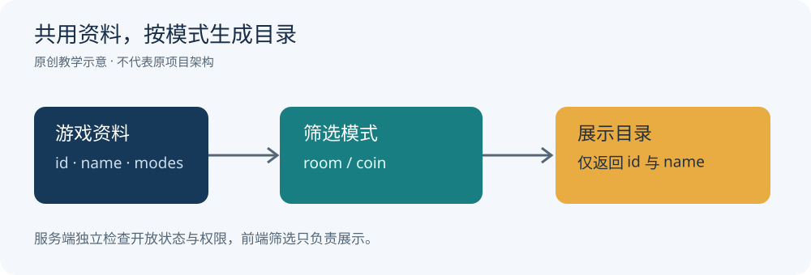

# 红鸟大众版：房间模式与游戏目录

红鸟大众版的公开介绍区分金币场和房卡场。房卡场包含斗地主、跑胡子、红中麻将、六胡抢、十三张、碰胡子、跑得快与血战麻将；两个模式的游戏目录存在交集。

本文以多模式目录为例，介绍如何共用游戏资料、按模式筛选入口，并用一段独立 JavaScript 示例演示实现。代码与流程图均为本文编写，不是红鸟原始工程或界面截图。

## 目录结构

一个游戏只维护一份基本资料，再通过 `modes` 声明它属于哪些目录。中文名称用于展示，稳定标识用于关联房间。这样修改名称或调整排序时，不会改变房间使用的玩法标识。

| 字段 | 用途 | 示例 |
| --- | --- | --- |
| id | 稳定玩法标识 | doudizhu |
| name | 显示名称 | 斗地主 |
| modes | 可出现的模式 | room、coin |

示例中的 `room` 和 `coin` 只表示目录分类，不定义购买、兑换或结算规则。



## 独立示例

```js
export function gamesForMode(games, mode) {
  if (!['room', 'coin'].includes(mode)) {
    throw new Error('未知模式');
  }
  return games
    .filter(game => game.modes.includes(mode))
    .map(({id, name}) => ({id, name}));
}

const games = [
  {id:'doudizhu', name:'斗地主', modes:['room', 'coin']},
  {id:'hongzhong', name:'红中麻将', modes:['room', 'coin']},
  {id:'demo-room', name:'示例房间玩法', modes:['room']}
];
console.log(gamesForMode(games, 'coin'));
```

最后一项是教学用的虚拟条目，用来展示不同模式的筛选效果，不计入红鸟玩法名单。运行结果只包含斗地主和红中麻将的标识与名称。

可运行文件：[catalog.mjs](catalog.mjs)。在安装 Node.js 的环境中执行：

```sh
node catalog.mjs
node test.mjs
```

## 数据边界

函数面向已经校验过的内部目录。返回结果创建新的对象，只暴露 `id` 和 `name`，调用方修改返回的显示名称不会改动原目录。目录顺序保持不变，前端可以直接按配置顺序展示。

如果目录来自网络响应或配置文件，加载时需要先检查字段类型、标识重复与模式取值；不要把外部输入直接当作可信目录。客户端筛选负责展示，真正创建房间时，服务端仍需检查该玩法是否允许使用，以及用户是否具有进入房间的权限。

当一个模式临时关闭时，应同时更新服务端开放状态。仅隐藏客户端入口无法阻止旧客户端发出创建请求。

## 验证

配套测试覆盖双模式共有条目、单模式条目、未知模式、空目录、顺序保持及返回对象与原目录的隔离。测试针对本文示例，不代表原游戏工程经过运行或部署测试。

## 资料与交流

玩法与模式资料来源：[九牛源码：红鸟大众版介绍](https://www.9nweb.com/post/4410.html)。本仓库提供技术文章、原创示意图和独立示例，不包含第三方游戏工程。

技术交流：[Telegram @root4433](https://t.me/root4433)。
